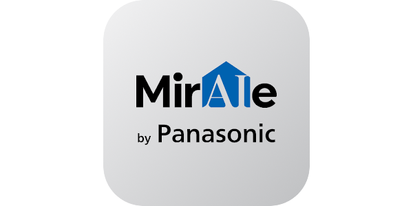

<p align="center">
  
</p>

<h1 align="center">Panasonic MirAIe</h1>

<p align="center">
  <strong>Your Panasonic smart home, connected to Home Assistant.</strong><br>
  Control air conditioners, fans, switches and plugs with live cloud updates.
</p>

<p align="center">
  <a href="https://github.com/KANDIYARR/panasonic-miraie/releases"></a>
  <a href="https://www.hacs.xyz/docs/faq/custom_repositories/"></a>
  <a href="#requirements"></a>
  <a href="LICENSE"></a>
</p>

<p align="center">
  <a href="https://github.com/KANDIYARR/panasonic-miraie/actions/workflows/tests.yml"></a>
  <a href="https://github.com/KANDIYARR/panasonic-miraie/actions/workflows/hacs.yml"></a>
  <a href="https://github.com/KANDIYARR/panasonic-miraie/actions/workflows/hassfest.yml"></a>
</p>

<p align="center">
  <a href="#installation">Installation</a> ·
  <a href="#supported-devices">Supported devices</a> ·
  <a href="#upgrading-from-upstream">Upgrade guide</a> ·
  <a href="#troubleshooting">Troubleshooting</a> ·
  <a href="https://github.com/KANDIYARR/panasonic-miraie/releases">Releases</a>
</p>

---

## Overview

Bring your MirAIe devices into the Home Assistant dashboard and use them in your
automations. This integration combines MQTT updates with REST fallback and
Panasonic OAuth sign-in.

| Capability | What it provides |
| --- | --- |
| **Live state updates** | Receive device changes through Panasonic's MQTT cloud connection. |
| **Resilient connections** | Restore subscriptions after reconnects and renew credentials independently of state updates. |
| **Clear command failures** | Report rejected commands without falsely changing the displayed device state. |
| **Private diagnostics** | Share device counts and connection health without account identifiers, device names or tokens. |

Maintained by **[Vinoth Sakthivel](https://github.com/KANDIYARR)** ·
[vinoth@kandiyar.com](mailto:vinoth@kandiyar.com).
An independent fork of [ha-panasonic-miraie](https://github.com/miraiehomeassistant/ha-panasonic-miraie), with original attribution preserved.

## Supported devices

| Device | Controls | MirAIe categories |
| --- | --- | --- |
| **Air conditioners** | Power, HVAC mode, target temperature, fan speed | `AC`, `ODMIRB-AC` |
| **Fans** | Power, five speed levels, auto / normal / turbo / sleep presets | `FANCONTROLLER` |
| **Switches & plugs** | Power and multichannel switch control | `SWITCHES`, `ROMASWITCHES`, `PLUG` |

## Requirements

- **Home Assistant 2024.11.3 or newer** — automated tests use this baseline; newer versions need deployment testing.
- **Region:** Panasonic MirAIe India cloud (`miraie.in`).
- A **Panasonic MirAIe account**, with devices already paired in the mobile app.
- Internet access to Panasonic's HTTPS services and `mqtt.miraie.in:8883`.
- **HACS** for the recommended installation method.

## Installation

### HACS · Recommended

[](https://my.home-assistant.io/redirect/hacs_repository/?owner=KANDIYARR&repository=panasonic-miraie&category=integration)

Use the button above, or add the repository manually:

1. Open **HACS → ⋮ → Custom repositories**.
2. Add the following URL and choose **Integration**:

   ```text
   https://github.com/KANDIYARR/panasonic-miraie
   ```

3. Find **Panasonic MirAIe** and download the latest release.
4. **Restart Home Assistant.**
5. Go to **Settings → Devices & services → Add integration → Panasonic MirAIe**.
6. Complete the Panasonic OAuth sign-in and link your account.

> **Distribution:** Available through HACS as a custom repository. This project is not listed in the HACS default catalog.

<details>
<summary><strong>Manual installation</strong></summary>

1. Download `panasonic-miraie-1.1.2.zip` from [Releases](https://github.com/KANDIYARR/panasonic-miraie/releases).
2. Copy the archive's `custom_components/panasonic_cloud` folder into your Home Assistant configuration:

   ```text
   config/
   └── custom_components/
       └── panasonic_cloud/
           ├── __init__.py
           ├── manifest.json
           └── ...
   ```

3. Restart Home Assistant, then add **Panasonic MirAIe** from **Settings → Devices & services**.
4. Complete the Panasonic sign-in.

</details>

### Upgrading from upstream

Back up your Home Assistant configuration first. Remove the original repository
from HACS before adding this fork, so only one repository manages the integration.
Install this version over `custom_components/panasonic_cloud` and restart.

**Keep your existing Home Assistant integration entry.** The domain and entity
unique IDs are unchanged, allowing existing entities and automations to be reused.
Do not install both versions under different component folders.

## What's improved in v1.1.1

- **Safer authentication:** OAuth response bodies stay out of logs, and HTTP requests have a 30-second timeout.
- **Better recovery:** Temporary cloud failures are distinguished from rejected credentials; MQTT subscriptions survive delayed connections and reconnects.
- **Independent renewal:** Token checks continue even when frequent MQTT messages postpone REST polling.
- **Accurate controls:** Failed commands surface errors; fan speed commands power the fan on, and switch commands preserve cached channel state until accepted.
- **Clean shutdown:** Setup failures and successful unloads stop connections and renewal timers.
- **Verifiable changes:** Privacy-preserving diagnostics, 17 regression tests, HACS validation and Hassfest checks.

Read the [changelog](CHANGELOG.md) or the [technical review](REVIEW.md).

## Troubleshooting

| Symptom | What to check |
| --- | --- |
| **No devices appear** | Confirm the account and paired devices in the MirAIe app. Reload the integration after adding new devices. |
| **Device unavailable** | Check the device in the MirAIe app, then check internet and cloud connectivity. |
| **Sign-in requested again** | Follow Home Assistant's reauthentication prompt. You do not need to remove the integration. |
| **Updates are delayed** | Allow outbound MQTT traffic on port `8883`. REST fallback normally runs after 15 minutes without push updates. |

Need help? [Open an issue](https://github.com/KANDIYARR/panasonic-miraie/issues)
with your Home Assistant version, device category and integration diagnostics.
**Never include credentials or access/refresh tokens.**

## Compatibility & limitations

Cloud connectivity is required. MQTT transport acceptance does not confirm that
an appliance applied a command. Authentication uses the first home ID, so MQTT
access across multiple homes remains unverified. Devices with unsupported REST
status queries rely on MQTT for state updates.

Energy monitoring and additional appliance categories are not implemented.
Live OAuth, physical appliance behavior and newer Home Assistant releases still
need deployment testing.

<details>
<summary><strong>Development & testing</strong></summary>

Use **Python 3.12**:

```sh
pip install -r requirements-test.txt
ruff check custom_components tests
pytest -q
```

Tests use real Home Assistant classes with mocked cloud transports. GitHub Actions
runs regression tests, HACS validation and Hassfest checks.

See [REVIEW.md](REVIEW.md) for findings and remaining deployment checks.

</details>

---

## Credits & license

**Author and maintainer:** Vinoth Sakthivel · [vinoth@kandiyar.com](mailto:vinoth@kandiyar.com)

Based on [miraiehomeassistant/ha-panasonic-miraie](https://github.com/miraiehomeassistant/ha-panasonic-miraie).
Upstream attribution: Panasonic Innovation Centre India and contributors.

Distributed under the **[Apache License 2.0](LICENSE)**.
See [AUTHORS.md](AUTHORS.md) and [NOTICE](NOTICE) for attribution.

<sub>This is an independently maintained integration, not an official Panasonic release. The MirAIe image identifies the supported platform.</sub>
